<p align="center">
  <picture>
    <source media="(prefers-color-scheme: dark)" srcset="assets/logo-dark.svg">
    
  </picture>
</p>

<h1 align="center">coderachnid</h1>

<p align="center"><em>It feels the thread before it snaps.</em></p>

<p align="center">
  
  
  
  
  
</p>

<p align="center">
  <picture>
    <source media="(prefers-color-scheme: dark)" srcset="assets/banner-dark.svg">
    
  </picture>
</p>

You know the loop. The agent writes three hundred lines and they run. Two days later you
are back, spending prompts on the auth check it skipped, the test that could never fail,
the migration that had no backup.

coderachnid gives your agent the sense to feel those threads **before** it writes. Each
phase is done once, done right, and closed with a short note on where your project
stands and what comes next.

## Built for tight budgets. Useful on any.

It was shaped with the $20 monthly plan in mind, where usage limits reset every few
hours and every do-over spends part of a window you then have to wait out. The same
discipline pays off on any plan.

- **Right the first time.** Security, tests and data safety are part of writing the
  code, not a review pass you pay for later.
- **One pass per phase.** A phased plan with frozen scope, so the agent finishes a stage
  before it starts the next one.
- **A project that explains itself.** Every development response ends with five points:
  the next phase, the keys of what was done, what to watch, the tests to run and the
  recommended next step. After a break, you know exactly where you are.

## Sifted, not dumped

There's a joke about AI-built apps: they are like poorly sifted cement. Everything is
dumped in at once, lumps and all, and when you press it into the mold it cracks and
leaves holes. Code written with discipline is like well-sifted cement: it spreads evenly
and sets dense and solid.

The model is already intelligent. What it lacks is **memory of what went wrong before**
and **the reflex to check instead of assume**. Every rule in this plugin was paid for in
a real project: a test that passed while the feature was broken, a backup that didn't
restore, a process kill that took down another app, a "zero violations" report from a
check that captured nothing.

## The senses

| Skill | Activates when | What it adds |
|---|---|---|
| `security-first` | Code touches untrusted input or sensitive data (any endpoint, form, upload, import, auth), each phase, every commit | Threat modeling fitted to the real threat model, trust boundaries, secret handling, security tests as acceptance criteria, a pre-commit checklist |
| `precise-code` | Writing or changing code | Read before change, no truncation, comments that explain *why*, reproducible outputs (own seeded generator, canonical inputs, byte-identical documents), dependencies vetted the day they enter, data files treated as code |
| `tests-that-bite` | A bug is reported or fixed, writing tests, deciding "done" | Failing test before the fix, positive controls, mutation testing read as questions, golden files, tests on the project's real content, negative cases that can actually fail |
| `safe-database` | Migrations, schema changes, data fixes, test runs | Backup → migrate → test → verify; disposable test databases; cleanup by id |
| `blind-spots` | Editing or reviewing CSS and layout, server templates, generated documents or PDFs, build files or scripts; before saying work is done | The traps agents repeatedly fall into, and the check for each |
| `phased-plan` | Planning, starting or closing a phase | One ordered plan, frozen scope, one branch per phase, sub-steps with a test the owner can run, product intent turned into checks, a living table of recommendations |
| `response-closing` | Development work (made always-on by the output style below) | Five points: next phase, keys, watch-outs, tests, next step |
| `pitfall-log` | Debugging something that behaved unexpectedly, or a fix that already failed | Turns each mistake into a dated rule with the check that catches it |
| `project-setup` | Starting a project or adopting coderachnid | Rules file, plan, ADR folder, database layout and project guards from templates |
| `sourced-data` | The product shows prices, statistics, research or rules people rely on | A primary source, date and range for every figure; "no source, no number" |
| `handoff` | The conversation has grown long, or you want to continue in a fresh session | A short handoff file so `/clear` costs nothing and the next session picks up the thread |
| `market-research` | Only when you run `/coderachnid:market-research` (no cost in other sessions) | Market size, demand drivers, competitors, unmet needs from real reviews and money flows, every figure sourced, ending in the riskiest assumptions and how to test them |

Stack-specific knowledge lives in each skill's `references/` and is loaded only when the
task needs it: Windows shells, Java/Spring, server-side templates and HTMX, web
frontend and generated art, documents rendered to screen and PDF, SQLite and MySQL, apps
served on the user's own machine, AI model integration, data files written by people
(YAML, JSON), reproducible outputs, and the ways a test passes without proving anything.

## Guards for your project

`project-setup` copies ready-made guards into your project. Each one passes or fails by
its exit code, and each was proven to fail on a known-bad case before shipping.

| Guard | What it proves |
|---|---|
| `check-forbidden-phrases.sh` | No promise your product must never make appears in user-facing text |
| `check-line-endings.sh` | Files compared byte for byte are pinned to LF and have no CRLF on disk |
| `run-checked.sh` | A build or test command's real exit code, not the one a pipe or a red console shows |
| `backup-before-migrate.sh` | A verified backup exists before a migration runs (SQLite or MySQL) |

## Install

In Claude Code:

```
/plugin marketplace add ru3enaa1/coderachnid
/plugin install coderachnid@coderachnid
```

To update later: `/plugin marketplace update coderachnid`.

To try a local clone without installing:

```sh
git clone https://github.com/ru3enaa1/coderachnid
claude --plugin-dir ./coderachnid
```

## Use

The skills activate on their own when the task matches their description. You can also
ask for one by name ("use safe-database before this migration"). To give a new project
the full structure, ask for **project-setup**.

Skills load per task, so the five-point closing on **every** development reply comes
from the plugin's output style. It keeps Claude Code's default behavior and tone and adds
only the closing. Select it once:

- in a project: `/output-style coderachnid:closing`
- in every project: `"outputStyle": "coderachnid:closing"` in `~/.claude/settings.json`

Prefer not to change your output style? Add this line to the project's `CLAUDE.md`
instead (`project-setup` adds it for you):

```markdown
Every development response closes with the five-point block: next phase · keys ·
watch-outs · recommended tests · recommended implementation.
```

On a capped plan, every installed skill's description is read in every session. For a
session that isn't development work, `/plugin disable coderachnid` and
`/plugin enable coderachnid` turn it off and on.

### Keep long sessions light: `coderachnid-relay`

Every message re-reads the whole conversation, so long sessions get expensive. The
optional second plugin in this repository keeps the thread in a short handoff file
instead: past a token threshold it asks Claude to write the handoff, you type `/clear`,
and the next session starts with the handoff loaded. It also warns before resuming a
large conversation whose cache has expired, and keeps every compaction summary.

```
/plugin install coderachnid-relay@coderachnid
```

Details, settings and an optional status line with your five-hour usage:
[plugins/relay/README.md](plugins/relay/README.md).

### Start with evidence: `/coderachnid:market-research`

Before building, run
`/coderachnid:market-research "idea" "customer" "industry" "regions"`. It writes
`docs/MARKET.md` with sourced figures and the three riskiest assumptions, which become
the plan's discovery phase before F0.

## How it is checked

- **Activation:** every skill has cases, in English and Spanish, for tasks that should
  trigger it and tasks that should not, run with `claude plugin eval` (`evals/`).
- **Value:** cases that compare the same task with and without the plugin, to keep only
  what changes the result.
- **Guards:** `guards/tests/test-guards.sh` plants a violation for every rule of every
  guard and fails if any guard lets it through.

## Design principles

1. **Three layers.** *Senses* (skills) say what to do and why. *Guards* (tests, scripts,
   architecture rules) prove it was done. *Templates* give every project the same shape.
   Instructions alone are suggestions; the guards make them rules.
2. **Every rule comes from a real failure.** It carries its reason and points to a check.
3. **Load only what's needed.** Short skills, with detail in `references/`, to keep the
   agent's context clean.
4. **No hooks by default.** Nothing runs on every turn unless you opt in; the hooks live
   in the separate `coderachnid-relay` plugin.
5. **Measured, not assumed.** A skill or a rule stays only if a test shows it fires when
   it should and changes the result.
6. **Vendor-neutral.** Patterns, not products.

## What it is not

- Not a code generator or a framework.
- Not a substitute for reading the code. It makes the agent read more, not less.
- Not tied to one language. The core skills are language-agnostic; stack references grow
  with contributions.

## Contributing

New pitfalls are welcome when they were confirmed in a real project. Generalize them,
attach the check that catches them, and see [CONTRIBUTING.md](CONTRIBUTING.md).

## License

[MIT](LICENSE)
