<p align="center">
  <picture>
    <source media="(prefers-color-scheme: dark)" srcset="assets/logo-dark.svg">
    
  </picture>
</p>

<h1 align="center">coderachnid</h1>

<p align="center"><em>It feels the thread before it snaps.</em></p>

<p align="center">
  
  
  
  
  
</p>

<p align="center">
  <picture>
    <source media="(prefers-color-scheme: dark)" srcset="assets/banner-dark.svg">
    
  </picture>
</p>

You know the loop. The agent writes three hundred lines and they run. Two days later you
are back, spending prompts on the auth check it skipped, the test that could never fail,
the migration that had no backup.

coderachnid gives your agent the sense to feel those threads **before** it writes. Each
phase is done once, done right, and closed with a short note on where your project
stands and what comes next.

## Built for tight budgets. Useful on any.

It was shaped with the $20 monthly plan in mind, where usage limits reset every few
hours and every do-over spends part of a window you then have to wait out. The same
discipline pays off on any plan.

- **Right the first time.** Security, tests and data safety are part of writing the
  code, not a review pass you pay for later.
- **One pass per phase.** A phased plan with frozen scope, so the agent finishes a stage
  before it starts the next one.
- **A project that explains itself.** Every development response ends with five points:
  the next phase, the keys of what was done, what to watch, the tests to run and the
  recommended next step. After a break, you know exactly where you are.

## Sifted, not dumped

There's a joke about AI-built apps: they are like poorly sifted cement. Everything is
dumped in at once, lumps and all, and when you press it into the mold it cracks and
leaves holes. Code written with discipline is like well-sifted cement: it spreads evenly
and sets dense and solid.

The model is already intelligent. What it lacks is **memory of what went wrong before**
and **the reflex to check instead of assume**. Most rules in this plugin were paid for in
a real project: a test that passed while the feature was broken, a backup that didn't
restore, a process kill that took down another app, a "zero violations" report from a
check that captured nothing. The rest come from what well-known engineers published:
each cites its source and is marked as anticipated until a project confirms it.

## The senses

| Skill | Activates when | What it adds |
|---|---|---|
| `security-first` | Code touches untrusted input or sensitive data (any endpoint, form, upload, import, auth), each phase, every commit | Threat modeling fitted to the real threat model, trust boundaries, secret handling, security tests as acceptance criteria, vulnerability scans before packaging, a pre-commit checklist |
| `precise-code` | Writing or changing code | Read before change, a working loop drawn from what well-known engineers published (understand first, data first, the simplest version as oracle, small steps), no truncation, comments that explain *why*, reproducible outputs (own seeded generator, canonical inputs, byte-identical documents), dependencies vetted the day they enter, data files treated as code |
| `tests-that-bite` | A bug is reported or fixed, writing tests, deciding "done" | Failing test before the fix, positive controls (also for every automated review check), mutation testing read as questions and per class, golden files, tests on the project's real content, negative cases that can actually fail |
| `safe-database` | Migrations, schema changes, data fixes, test runs | Backup → migrate → test → verify; disposable test databases; cleanup by id |
| `blind-spots` | Editing or reviewing CSS and layout, server templates, generated documents or PDFs, build files or scripts; before saying work is done | The traps agents repeatedly fall into, and the check for each |
| `phased-plan` | Planning, starting or closing a phase | One ordered plan, frozen scope, one branch per phase, sub-steps with a test the owner can run, product intent turned into checks, a living table of recommendations |
| `response-closing` | Development work (made always-on by the output style below) | Five points: next phase, keys, watch-outs, tests, next step |
| `pitfall-log` | Debugging something that behaved unexpectedly, or a fix that already failed | Turns each mistake into a dated rule with the check that catches it |
| `project-setup` | Starting a project or adopting coderachnid | Rules file, plan, ADR folder, database layout and project guards from templates |
| `sourced-data` | The product shows prices, statistics, research or rules people rely on | A primary source, date and range for every figure; "no source, no number" |
| `handoff` | The conversation has grown long, or you want to continue in a fresh session | A short handoff file so `/clear` costs nothing and the next session picks up the thread |
| `market-research` | Only when you run `/coderachnid:market-research` (no cost in other sessions) | The idea framed as a problem, people already describing it in open communities, products that already earn money from it, market size, the top ten problems, competitors on a positioning map with the free position, every figure and quote sourced, ending in a verdict per claim and the riskiest assumptions with their tests |
| `offer` | Only when you run `/coderachnid:offer` (no cost in other sessions) | A one-sentence value proposition, three price tiers anchored to competitor prices, a guarantee you can honor, the cheapest test of the offer, and the promises the product must never make |
| `product-brief` | Only when you run `/coderachnid:product-brief` (no cost in other sessions) | A structured PRD (what is being built, for whom and where, the problem, core features and how each works, stories with acceptance criteria, data and threats, frozen MVP scope) and a design brief with a mockup prompt for your design tool |

Stack-specific knowledge lives in each skill's `references/` and is loaded only when the
task needs it: Windows shells, Java/Spring, server-side templates and HTMX, web
frontend and generated art, documents rendered to screen and PDF, SQLite and MySQL, apps
served on the user's own machine, desktop apps (a native window, the installer, the
release), vulnerability scans and release artifacts, importing a customer's file, AI
model integration, data files written by people (YAML, JSON), reproducible outputs, the
ways a test passes without proving anything, engineering craft with its sources, demand
signals and how to read revenue estimates, the structure of a PRD, and an editorial
design direction for product pages.

## Guards for your project

`project-setup` copies ready-made guards into your project. Each one passes or fails by
its exit code, and each was proven to fail on a known-bad case before shipping.

| Guard | What it proves |
|---|---|
| `check-forbidden-phrases.sh` | No promise your product must never make appears in user-facing text |
| `check-line-endings.sh` | Files compared byte for byte are pinned to LF and have no CRLF on disk |
| `run-checked.sh` | A build or test command's real exit code, not the one a pipe or a red console shows |
| `backup-before-migrate.sh` | A verified backup exists before a migration runs (SQLite or MySQL) |

## Install

From a terminal, inside the folder of the project that will use it:

```sh
claude plugin marketplace add ru3enaa1/coderachnid
claude plugin install coderachnid@coderachnid --scope local
```

- **`--scope local` turns it on for this project only.** Without it, the plugin is
  installed for every project (`--scope user`), and every session there reads its skill
  descriptions.
- **The terminal app also has these commands as `/plugin …`.** Some IDE extensions don't
  offer `/plugin`; the `claude` CLI always works. The VS Code extension ships one inside
  its own folder when `claude` isn't on your `PATH`.
- **Updating takes two steps,** inside the project:

  ```sh
  claude plugin marketplace update coderachnid
  claude plugin update coderachnid@coderachnid --scope local
  ```

  The first only refreshes the catalog: the installed plugin keeps its old version
  until the second runs.
- **A local install is tied to the folder's path.** After renaming or moving the folder,
  run the install again inside it.

To try a local clone without installing:

```sh
git clone https://github.com/ru3enaa1/coderachnid
claude --plugin-dir ./coderachnid
```

## Use

Eleven skills activate on their own when the task matches their description; you can
also ask for one by name ("use safe-database before this migration"). The three
discovery skills run only when you type their command, so they cost nothing in other
sessions.

### From idea to release

1. **Install it in the project** (above) and choose the closing (below).
2. **Discovery**, one command per session: `market-research`, then `offer`, then
   `product-brief` (see "Start with evidence"). Decide "go" on the market report's
   verdicts, or record that you build first and defer its tests.
3. **Set up:** ask for a stack proposal as an ADR, then for **project-setup**. It writes
   the project rules file, the plan seeded from the PRD, the first ADR, the database
   layout and the project guards.
4. **Build phase by phase** ("start F0", then F1…). `phased-plan` keeps the order and the
   frozen scope. While you work, `precise-code`, `tests-that-bite`, `security-first`,
   `safe-database`, `sourced-data` and `blind-spots` step in on their own, and
   `pitfall-log` turns each surprise into a dated rule.
5. **Keep sessions light:** `handoff`, or the relay below, before each `/clear`.
6. **Release:** vulnerability scans before packaging and checksums from the shipped file
   (`security-first`), installer traps (`blind-spots`). After the milestone, run the
   tests you deferred and validate in the field before adding phases.

### The five-point closing

Skills load per task, so the five-point closing on **every** development reply comes
from the plugin's output style. It keeps Claude Code's default behavior and tone and adds
only the closing. Select it once:

- in one project: `"outputStyle": "coderachnid:closing"` in the project's
  `.claude/settings.local.json` (the `/output-style` command, where your Claude Code
  has it, saves the same setting);
- in every project: the same line in `~/.claude/settings.json`.

Prefer not to change your output style? Add this line to the project's `CLAUDE.md`
instead (`project-setup` adds it for you):

```markdown
Every development response closes with the five-point block: next phase · keys ·
watch-outs · recommended tests · recommended implementation.
```

On a capped plan, every enabled skill's description is read in every session. Install
the plugin only in the projects that use it, and switch it off in one of them with
`claude plugin disable coderachnid@coderachnid --scope local` (`enable` turns it back on).

### Keep long sessions light: `coderachnid-relay`

Every message re-reads the whole conversation, so long sessions get expensive. The
optional second plugin in this repository keeps the thread in a short handoff file
instead: past a token threshold it asks Claude to write the handoff, you type `/clear`,
and the next session starts with the handoff loaded. It also warns before resuming a
large conversation whose cache has expired, and keeps every compaction summary.

```sh
claude plugin install coderachnid-relay@coderachnid --scope local
```

Details, settings and an optional status line with your five-hour usage:
[plugins/relay/README.md](plugins/relay/README.md).

### Start with evidence: the discovery chain

Before building, three commands take an idea to requirements the code can start from.
Run each one by hand, in its own session; each reads the files the previous one wrote.

1. `/coderachnid:market-research "idea or problem" "customer" "industry" "regions"`
   writes `docs/MARKET.md`. It frames the idea as a problem, looks for people already
   describing it in forums and reviews (quotes only from pages it opened), finds
   products that already earn money from it, then sizes the market, ranks the top ten
   problems and maps the five main competitors and the position none of them holds. It
   ends with a verdict for each claim the idea makes and the three riskiest assumptions.
2. `/coderachnid:offer "product"` writes `docs/OFFER.md`: what you sell, to whom, at
   which price (anchored to the competitors' prices and labelled an assumption until
   tested), the cheapest way to test it, and a list of promises your product must never
   make, ready for the forbidden-phrases guard.
3. `/coderachnid:product-brief "product"` writes two documents. `docs/PRD.md` holds the
   requirements in a fixed structure: what is being built, for whom and where, the
   problem, the core features and how each works, stories with acceptance criteria,
   personal data and threats, entities, and the frozen MVP scope, all traced back to the
   problems in the market report. `docs/BRIEF.md` holds a design direction chosen to
   stand apart from the competitors and a mockup prompt for your design skill or image
   generator.

Before the third command, put your logo, typefaces, colors and the pages you like in a
`brand/` or `docs/` folder: `product-brief` reads them first and asks only for what is
missing. Your own references always win over the brief's proposal. The PRD becomes the
plan's frozen scope before F0.

On a fictional product, `product-brief` delivered every section of both documents in 2
of 2 runs, where a loose prompt for the same two documents covered 32%; `offer`
delivered every section in 2 of 2 runs against 10% (`evals/chain/`). `market-research`
needs live web search and is not part of that measurement. The chain has since run on
one real project, and what that run showed is in the current version.

## How it is checked

- **Activation:** every skill that activates on its own has cases, in English and
  Spanish, for tasks that should trigger it and tasks that should not, run with
  `claude plugin eval` (`evals/`).
- **Value:** cases that compare the same task with and without the plugin, to keep only
  what changes the result.
- **Documents:** `offer` and `product-brief` are graded on the files they write, by
  graders that first had to pass a known-good document and fail a known-bad one
  (`evals/chain/`). `market-research` needs live web search, so it is tried on real
  projects instead.
- **Guards:** `guards/tests/test-guards.sh` plants a violation for every rule of every
  guard and fails if any guard lets it through.

## Design principles

1. **Three layers.** *Senses* (skills) say what to do and why. *Guards* (tests, scripts,
   architecture rules) prove it was done. *Templates* give every project the same shape.
   Instructions alone are suggestions; the guards make them rules.
2. **Every rule says where it comes from:** a real failure, or a published source. It
   carries its reason and points to a check, and a rule no project has confirmed yet is
   marked as anticipated.
3. **Load only what's needed.** Short skills, with detail in `references/`, to keep the
   agent's context clean.
4. **No hooks by default.** Nothing runs on every turn unless you opt in; the hooks live
   in the separate `coderachnid-relay` plugin.
5. **Measured, not assumed.** Skills are measured for when they fire and for what they
   change; what can't be measured yet says so and is tried on real projects.
6. **Vendor-neutral.** Patterns, not products.

## What it is not

- Not a code generator or a framework.
- Not a substitute for reading the code. It makes the agent read more, not less.
- Not tied to one language. The core skills are language-agnostic; stack references grow
  with contributions.

## Contributing

New pitfalls are welcome when they were confirmed in a real project. Generalize them,
attach the check that catches them, and see [CONTRIBUTING.md](CONTRIBUTING.md).

## License

[MIT](LICENSE)
